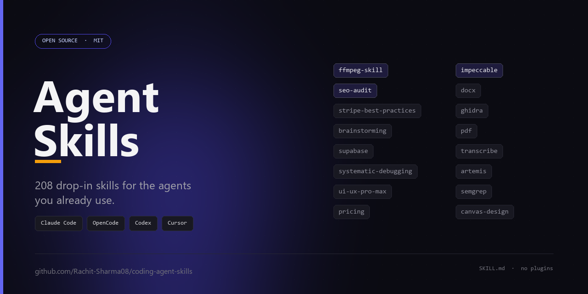

<p align="center">
  
</p>

<h1 align="center">Agent Skills</h1>

<p align="center">
  <b>208 drop-in skills that make coding agents good at the work around the code</b><br>
  Claude Code · OpenCode · Codex · Cursor · Gemini CLI · any agent that reads <code>SKILL.md</code>
</p>

<p align="center">
  <a href="SKILLS.md"></a>
  <a href="LICENSE"></a>
  <a href="SETUP.md"></a>
  <a href="https://github.com/Rachit-Sharma08/coding-agent-skills/stargazers"></a>
</p>

---

A skill is a folder with a `SKILL.md` file: a description the agent matches against your
request, plus the actual instructions it loads when the match happens. No plugins, no
framework, no code to run. Copy the folder, and your agent suddenly knows how to cut a
video with ffmpeg, audit a page for SEO, build a Stripe checkout, or decompile a binary.

This repo is a working collection — every skill here is installed, used and edited in daily
work, not scraped into a dump. Descriptions were tightened, triggers added (some in
Hinglish, because that is how the owner talks to his agent), and the noisy ones pruned.

## What's inside

| Area | Examples |
| --- | --- |
| **Video & audio** | `ffmpeg-skill` (42 scripts), `video-use`, `remotion-*`, `hyperframes`, `ai-video-maker`, `transcribe`, `speech` |
| **Design & frontend** | `impeccable`, `design-taste-frontend`, `ui-ux-pro-max`, `awesome-design-md`, `image-to-code`, `canvas-design`, `shadcn` |
| **Marketing & SEO** | `seo-audit`, `ai-seo`, `cro`, `copywriting`, `ads`, `emails`, `launch`, `pricing`, `geo-*` |
| **Docs & files** | `docx`, `pdf`, `pptx`, `xlsx`, `doc-coauthoring` |
| **Backend & infra** | `stripe-best-practices`, `supabase`, `neon`, `prisma-client-api`, `better-auth-*`, `workers-best-practices` |
| **Agent workflow** | `brainstorming`, `writing-plans`, `executing-plans`, `systematic-debugging`, `test-driven-development`, `verification-before-completion` |
| **Security & RE** | `security-review`, `semgrep`, `codeql`, `ghidra`, `ghidra-mcp-analysis`, `binary-ninja-mcp-analysis`, `find-bugs` |
| **Automation** | `pc-control`, `webapp-testing`, `playwright`-driven checks, `artemis-android-control` |

The full list with one-line summaries: **[SKILLS.md](SKILLS.md)**.

## Quick start

```bash
git clone https://github.com/Rachit-Sharma08/coding-agent-skills.git
cd coding-agent-skills
```

**OpenCode** (global, all projects):

```powershell
# Windows
Copy-Item -Recurse -Force .\skills\* "$env:USERPROFILE\.agents\skills\"

# macOS / Linux
cp -R skills/* ~/.agents/skills/
```

**Claude Code** (personal skills):

```bash
cp -R skills/* ~/.claude/skills/
```

**Project-local** (any agent, checked into your repo):

```bash
mkdir -p .agents/skills && cp -R skills/impeccable skills/ffmpeg-skill .agents/skills/
```

One skill, one folder — you never have to install all 208. Copy the five you will actually
use; the agent's context stays small and it stops guessing which skill you meant.

Then just ask for the work. Say *"cut this clip to 30 seconds and burn in captions"* and
`ffmpeg-skill` loads itself. Say *"why is this page not converting"* and `cro` loads.

Windows helper that copies to a target folder for you:

```powershell
.\scripts\install.ps1 -Target opencode      # or claude, or -Path D:\my-project\.agents\skills
```

Full instructions, verification steps and troubleshooting: **[SETUP.md](SETUP.md)**.

## How a skill works

```markdown
---
name: ffmpeg-skill
description: Edit video and audio with local FFmpeg... Use whenever the user mentions
  a video file, captions, a reel, LUFS, transcoding...
metadata:
  opencode/autoinvoke: true
---

# ffmpeg-skill
...the actual instructions, scripts and rules the agent follows...
```

- `description` is the only thing the agent sees up front. It is the trigger, not marketing copy.
- `metadata.opencode/autoinvoke: true` tells OpenCode to auto-load the skill on a match
  instead of waiting for `/skill`. Other agents ignore the field — harmless.
- Everything else in the folder (scripts, templates, references) is loaded only if the skill
  decides it needs it, so big skill folders do not blow up your context.

## Picking the right skill (why this repo doesn't fight itself)

With 200+ skills installed, the failure mode is not "no skill" — it is three skills firing at
once. The rule used here, and the one in the setup guide:

1. Load a skill only when the request **clearly** matches its description, not on one shared keyword.
2. Max **3 skills** per task. If two match, take the more specific one (`video-edit`, not `ads`).
3. No match? Work without one. A forced skill is worse than none.

## Repo layout

```
skills/<name>/SKILL.md   the skill + its scripts, templates and references
SKILLS.md                catalog of all 208 skills, A–Z
SETUP.md                 install, verify, troubleshoot
CREDITS.md               who wrote what, and the licenses
PROMOTION.md             launch kit (repo description, topics, ready-to-post copy)
scripts/build_catalog.py regenerates SKILLS.md from frontmatter
scripts/install.ps1      copy skills into an agent's skill folder
```

## Credits

Built and maintained by **[Rachit Sharma](https://github.com/Rachit-Sharma08)**, who collected,
edited and wired these skills together.

Many skills are adapted from public work — Anthropic's official skills, `obra/superpowers`,
Corey Haines' marketing skills, `kajisho5/ffmpeg-skill`, Browser Use's `video-use`, OWASP
cheat sheets, and others. Each folder keeps its own license when it has one; see
**[CREDITS.md](CREDITS.md)** for the list and the takedown policy.

## License

Repo scaffolding (docs, scripts, catalog) is MIT. Skills keep their own license — check
`skills/<name>/LICENSE` before redistributing a folder on its own.

---

<p align="center">
  <b>If one of these saved you an afternoon, star the repo.</b><br>
  It is the only signal that tells other people the collection is worth trusting.
</p>
