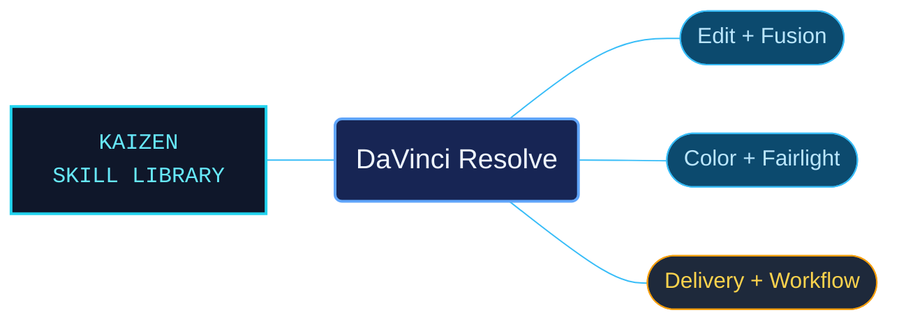

# DaVinci Resolve

DaVinci Resolve reference material organized around the work of editing, compositing, grading, mixing and delivery. The package combines routes into the Resolve 20.3 manual with a separately identified Resolve 21 New Features Guide, preserving the distinction between their procedures.

Use when working in DaVinci Resolve: Media, Cut, Edit, Fusion, Color, Fairlight, Deliver, or the Resolve 21 Photo page; media/proxies, timelines, trimming, transitions, titles, grading, RCM/ACES/LUTs, nodes, Resolve FX, audio, rendering, project libraries, Blackmagic Cloud, collaboration, immersive workflows, DCTL, or transport controls. Use for documented controls, menu paths, shortcuts, procedures, and version-specific behavior. Covers the Resolve 20.3 Reference Manual and the separate Resolve 21 New Features Guide. Not for other editing or audio applications.

## What this skill helps with

| Task | Useful reference material |
| --- | --- |
| [Build and refine an edit](references/edit/INDEX.md) | Locate timeline, trimming, track and multicamera workflows. |
| [Composite and animate](references/fusion/INDEX.md) | Follow Fusion workflows, then consult the separate node and modifier references. |
| [Grade and manage color](references/color/INDEX.md) | Find grading controls and node workflows alongside color-management and HDR guidance. |
| [Mix and deliver](references/fairlight/INDEX.md) | Navigate Fairlight recording, editing and mixing, with linked delivery and export routes. |

## The work behind the references

Manual material is interpreted into page and workflow categories with descriptive topic names. Controls, shortcuts and procedure conditions remain associated with their subject, while the Resolve 21 additions have a separate reference area.

## Start here

Start with [SKILL.md](SKILL.md) and follow its context routes.

Read [version and scope guidance](references/reading-versioned-references.md) before applying a procedure. Select the [Resolve 21 guide](references/resolve-21/INDEX.md) for its specific additions, including the Photo page, rather than assuming those features exist in 20.3.

## Sources and license

Skill reference documentation is interpreted content for use in open source projects. Check against [official documentation sources](https://www.blackmagicdesign.com/support/family/davinci-resolve-and-fusion) when dealing with defects or issues that may come up from interpreting this skill's references.

Licensed under **AGPL-3.0**; see [LICENSE](LICENSE). Part of the [Agent Kaizen](https://github.com/LevyBytes/agent-kaizen) skill library.
